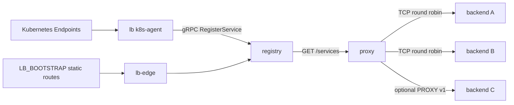

# lb

> Part of the **Strata** platform.

L4 load balancer with a decoupled registry control plane and a TCP proxy data plane. Kubernetes endpoints, static bootstrap entries, and Guardian-deployed workloads publish intent to the registry; the proxy opens listeners on demand and balances connections across healthy backends.

## Architecture



| Component | Binary | Responsibility |
|---|---|---|
| Registry | `cmd/registry` | gRPC `DiscoveryRegistry` (`RegisterService`, `DeregisterService`, `ListServices`), HTTP `/services` snapshot, `/healthz`, and a service dashboard |
| Proxy | `cmd/proxy` | Polls the registry snapshot, opens listeners per external port, round-robins across healthy backends, passive circuit breaking, draining, optional PROXY protocol v1 |
| Kubernetes agent | `cmd/k8s-agent` | Watches Endpoints objects and registers/deregisters their addresses from annotations |
| Edge | `cmd/edge` | All-in-one registry plus proxy used as the container entrypoint |

### Data flow

1. A producer registers one or more backends for an external port. The registry assigns a port from the configured range when the intent does not pin one, and tracks each backend's health and draining state.
2. The proxy syncs `GET /services` every `--sync-every` (default `2s`). It opens a listener for new external ports and closes listeners that no longer have backends.
3. Connections are balanced round-robin. Three consecutive dial failures trip a passive circuit breaker for that backend. Draining backends stay in rotation until their active connections reach zero.
4. Metrics are exported in Prometheus format on `:9090` for the standalone proxy and `:19090` for edge mode.

### Kubernetes intent

The agent reads the following annotations from the **Endpoints** object, falling back to the parent **Service**:

| Annotation | Meaning |
|---|---|
| `guardian.intent/expose` | `"true"` registers the endpoint |
| `guardian.intent/account` | Account/tenant, defaults to the namespace |
| `guardian.intent/service-name` | Service name, defaults to the Endpoints name |
| `guardian.intent/external-port` | Optional pinned external port |

## Quick start

```bash
go run ./cmd/registry
# in another shell
go run ./cmd/proxy -registry-url http://127.0.0.1:8081
```

The standalone registry listens on gRPC `:50051` and HTTP `:8081`; the proxy
exports metrics on `:9090`.

## Edge mode

The container image defaults to `lb-edge`, which runs a local registry and proxy
pair. Use `LB_BOOTSTRAP` to seed static routes for existing systems:

```bash
LB_BOOTSTRAP="9090=router-a:9090,router-b:9090;8080=router-a:8080,router-b:8080" ./edge
```

Format: `<external_port>=host:port[,host:port][;<external_port>=...]`. An
extended listener spec is also supported: `name@protocol[description]:port`,
for example `grpc@grpc:9090` or `monofs-http[MonoFS UI]:8080`.

Edge defaults differ from the standalone binaries:

| Listener | Standalone | Edge |
|---|---|---|
| Registry gRPC | `:50051` | `0.0.0.0:15051` |
| Registry HTTP | `:8081` | `127.0.0.1:18081` |
| Proxy metrics | `:9090` | `:19090` |

Most edge flags also accept environment variables: `LB_BIND_ADDRESS`,
`LB_SERVICE_BASE`, `LB_ACCOUNT`, `LB_BOOTSTRAP`, `LB_METRICS_ADDR`,
`LB_REGISTRY_HTTP_ADDR`, `LB_REGISTRY_GRPC_ADDR`, `LB_SYNC_EVERY`,
`LB_DIAL_TIMEOUT`, `LB_PROXY_PROTOCOL`.

## Build and test

```bash
go build ./...
go test ./...
```

## License

Licensed under the Apache License, Version 2.0. See [LICENSE](LICENSE).
